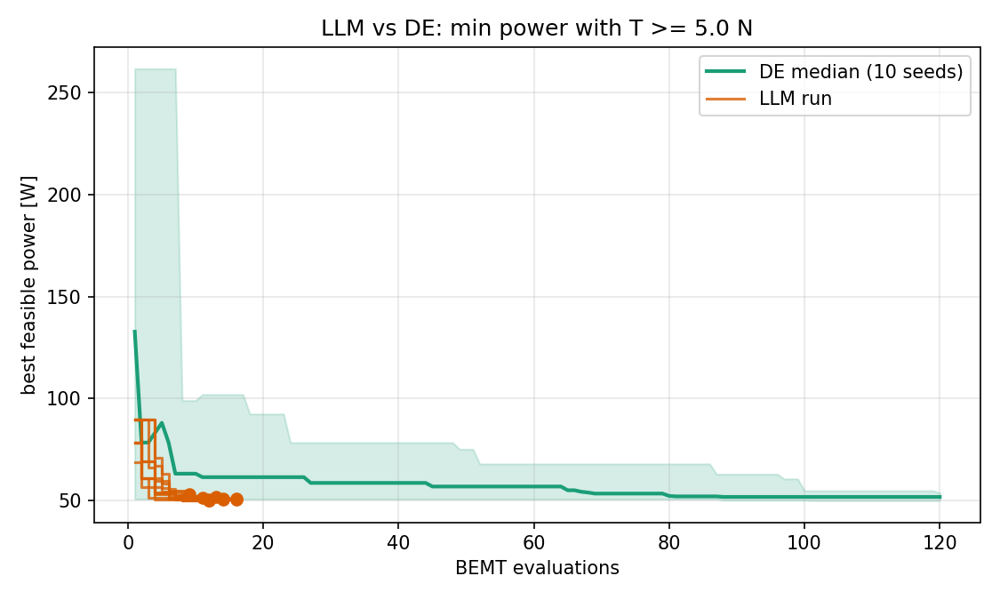
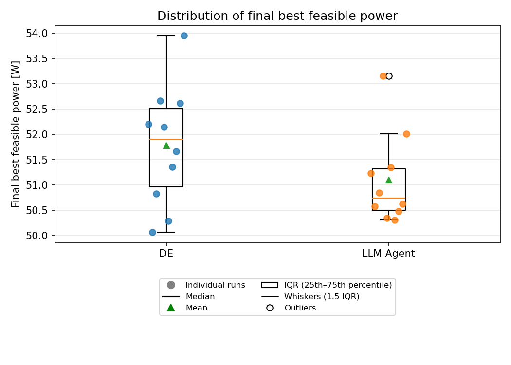
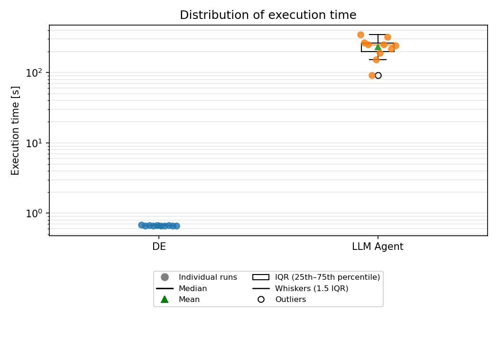

# LLM Propeller Design

**LLM-guided propeller geometry optimization using Blade Element Momentum Theory (BEMT), benchmarked against Differential Evolution (DE).**

## Overview

This project investigates whether a Large Language Model (LLM) agent can guide propeller geometry optimization through iterative engineering evaluation and feedback.

The agent proposes candidate geometries, evaluates them using a deterministic aerodynamic model, interprets the resulting performance metrics, and uses this feedback to guide subsequent design proposals.

Numerical calculations are performed by Python tools, while the LLM coordinates the design exploration process.

The approach is benchmarked against **Differential Evolution (DE)** using the same BEMT evaluator, design bounds, operating conditions, and feasibility criteria.

Rather than attempting to replace conventional numerical optimization, this project investigates an alternative approach to engineering design exploration in which an LLM guides the selection of candidate geometries.

## Engineering problem

The propeller design problem is formulated as a constrained optimization task for a drone propeller operating in hover, with zero freestream velocity (\(V = 0\)):

- **Objective:** minimize `P(x)`
- **Constraint:** `T(x) >= T_min`

where:

- `P(x)` is the power required by the propeller.
- `T(x)` is the predicted thrust.
- `T_min` is the minimum required thrust.
- `x` is the vector of design variables, comprising the root and tip pitch angles and chord lengths.

The blade geometry is parameterized by four variables:

| Variable | Description |
|---|---|
| `beta_root_deg` | Blade pitch angle at the root |
| `beta_tip_deg` | Blade pitch angle at the tip |
| `c_root` | Chord length at the root |
| `c_tip` | Chord length at the tip |

Variable bounds and fixed operating conditions are defined in `problem.py`.

This reduced parameterization keeps the design space manageable while allowing exploration of different pitch and chord distributions.

## Related work

Sedelnikov et al. (2024) presented a methodology for propeller geometry optimization based on Differential Evolution, aiming to minimize the power required to achieve a specified thrust. Their approach uses Bézier curves to parameterize the blade geometry, allowing the chord distribution, airfoil shape, and effective angle of attack to vary along the blade span. This parameterization provides greater geometric flexibility, including the possibility of using different airfoil shapes at different radial positions.

The aerodynamic performance is evaluated using a modified Isolated Sections Method (ISM), an approach similar to Blade Element Momentum Theory (BEMT), combined with aerodynamic data generated using XFOIL. An important feature of their method is the use of the effective angle of attack at each blade section as a design variable, from which the corresponding geometric twist is determined. The optimization problem is handled using an adaptive variant of Differential Evolution and a penalty function to account for the required thrust constraint.

The authors demonstrate the methodology through the optimization of tractor and helicopter propellers for unmanned aerial vehicles. Their aerodynamic model is compared against experimental and CFD results, and an optimized propeller is manufactured and experimentally tested. The study considers a relatively flexible geometric parameterization with up to 27 design variables.

The present project addresses a related engineering problem but investigates a different approach to design-space exploration. Instead of relying exclusively on a population-based optimization algorithm, it employs an LLM agent to propose candidate geometries, interpret aerodynamic evaluation feedback, and guide subsequent design iterations. The geometry is represented by four design variables, and performance is evaluated using a deterministic BEMT implementation. Differential Evolution is also implemented as a baseline, allowing the LLM-guided exploration to be compared with a conventional numerical optimization method under the same aerodynamic model and design constraints.

**Reference**

Sedelnikov, A., Kurkin, E., Quijada-Pioquinto, J. G., Lukyanov, O., Nazarov, D., Chertykovtseva, V., Kurkina, E., & Hoang, V. H. (2024). Algorithm for Propeller Optimization Based on Differential Evolution. *Computation, 12*(3), 52. https://doi.org/10.3390/computation12030052

## Methodology

### 1. Aerodynamic evaluation

The project uses a Blade Element Momentum Theory (BEMT) model to estimate propeller performance under the specified operating conditions.

The aerodynamic model is implemented in Python and couples blade element theory with momentum theory. The blade is discretized into 12 radial stations, where local aerodynamic forces are calculated using blade element theory. Momentum theory is coupled with this formulation to determine the induced velocities through an iterative fixed-point process. At each station, the induced velocities and aerodynamic forces are updated until convergence is achieved.

Once the local calculations are completed, the contributions from all blade stations are integrated to estimate the overall propeller thrust, torque, and required power. This coupled formulation allows the aerodynamic performance of each candidate geometry proposed by the LLM to be evaluated using the same deterministic engineering model.

The model is configured for hover operation, with zero freestream velocity (\(V = 0\)). Lift and drag coefficients are obtained from precomputed XFOIL polars for the NACA 4412 airfoil. These data are stored in `data/` and processed by `polar.py`, which provides aerodynamic coefficients as functions of angle of attack and Reynolds number.

This provides a deterministic and computationally inexpensive model for repeated design evaluations.

### 2. Polar interpolation and validity

The aerodynamic model relies on precomputed XFOIL polars covering finite ranges of angle of attack and Reynolds number.

The aerodynamic polar data for the NACA 4412 airfoil were obtained from [Airfoil Tools](http://airfoiltools.com/). The polars were generated using XFOIL with `Ncrit = 5` and Mach number zero.

Lift and drag coefficients are obtained through linear interpolation in angle of attack and Reynolds number. When a query falls outside the available polar ranges, the lookup is bounded by the nearest available boundary and flagged as extrapolated.

Although boundary values are used internally during the BEMT iterations, they are not accepted as valid aerodynamic predictions. If the angle of attack or Reynolds number at any blade station falls outside the available polar data, the candidate geometry is rejected.

A candidate is also rejected if the iterative induction solver fails to converge at any blade station.

Consequently, only geometries for which all blade stations remain within the available polar ranges and the induction solver converges are accepted for performance evaluation.

These validity checks prevent optimization from treating aerodynamic coefficients obtained outside the available XFOIL data ranges as reliable predictions.

### 3. LLM-guided design

The agent uses a Large Language Model (LLM) to guide the exploration of candidate propeller geometries through iterative interaction with deterministic engineering tools.

The workflow follows a feedback-driven process:

1. **Geometry proposal:** The LLM proposes a candidate blade geometry within the defined design space.
2. **Validation and evaluation:** Python tools validate the candidate and evaluate its aerodynamic performance using the BEMT model.
3. **Feedback:** Evaluation results and available diagnostic information are returned to the agent, including information from unsuccessful evaluations.
4. **Design refinement:** The LLM interprets the engineering feedback and proposes a new candidate geometry.
5. **Termination:** The process continues until the agent terminates the exploration or reaches its evaluation budget.

Evaluation metrics and diagnostic information are recorded even when a candidate is rejected or the aerodynamic solver fails to converge. This information is made available to the LLM, allowing it to identify problematic design characteristics and use previous evaluation outcomes to guide subsequent proposals.

The agent's behavior, design constraints, and tool usage guidelines are defined in `system_prompt.md`.

The LLM is responsible for guiding the design exploration and interpreting evaluation feedback, while all numerical calculations are performed by deterministic Python tools. This separation ensures that aerodynamic performance metrics are obtained from the engineering model rather than generated by the language model.

### 4. Differential Evolution baseline

Differential Evolution (DE) is a population-based optimization algorithm that searches for optimal solutions through iterative mutation, crossover, and selection operations. At each generation, new candidate solutions are generated by combining existing population members. These candidates are evaluated against the objective function and replace their corresponding individuals when they provide better solutions.

In this project, DE is used as a conventional numerical optimization baseline to compare its performance with the LLM-guided design exploration approach.

The algorithm optimizes the same four blade geometry parameters, subject to the same variable bounds and operating conditions. Each candidate geometry is evaluated using the same deterministic BEMT model employed by the LLM agent. The optimization objective is to minimize power consumption while satisfying the minimum thrust requirement.

The DE implementation uses the following configuration:

- **Strategy:** `best1bin`
- **Initialization:** Latin hypercube
- **Mutation range:** `(0.5, 1.0)`
- **Recombination factor:** `0.7`
- **Final polishing:** disabled

Independent runs are performed using different random seeds, with a fixed budget of BEMT evaluations for each run.

## Benchmark methodology

The benchmark compares independent LLM-agent runs against multiple DE runs using different random seeds.

The experimental setup is configured as follows:

- **LLM agent:** 10 independent runs.
- **Differential Evolution:** 10 random seeds.
- **DE evaluation budget:** 120 BEMT evaluations per seed.
- **Report checkpoints:** 10, 20, 40, 80, and 120 evaluations.
- **Common evaluator:** the same deterministic BEMT implementation.

The comparison uses the number of calls to `evaluate_blade_design` as its evaluation-budget unit.

Each call counts as one evaluation, including invalid candidates. Other engineering tool calls, such as `blade_element_force`, are recorded separately and do not consume this budget.

LLM candidates outside the defined design bounds or using different fixed operating conditions are counted but excluded from comparable solutions.

The benchmark replays the logged LLM evaluation calls through the shared evaluator, allowing the results to be audited and compared under consistent evaluation rules.

The analysis includes:

- Best feasible power as a function of the number of evaluations.
- Distribution of final feasible power.
- Wall-clock execution time.
- Feasibility and validity of evaluated candidates.

The evaluation budget and wall-clock time are treated as separate metrics. LLM inference introduces API latency and computational overhead that are not represented by the number of BEMT evaluations.

## Results and observations

The benchmark compares the LLM agent and Differential Evolution in terms of convergence behavior, final solution quality, and wall-clock execution time. The results are based on 10 independent runs for each approach.

### Convergence

The convergence plot illustrates how the best feasible power evolves with the number of BEMT evaluations.

The LLM agent found a feasible design in the first evaluation in all 10 runs. Its executions terminated after 9 to 16 evaluations, with an average of 12.9 evaluations per run.

Differential Evolution also found feasible solutions early in most runs: seven out of ten runs found their first feasible design in the first evaluation. However, DE continued exploring the design space for the full budget of 120 evaluations per run.

These results indicate that the LLM agent was able to identify feasible regions of the design space with relatively few evaluations. However, early feasibility does not necessarily imply that the best attainable solution has been found.

<p align="center">
  
</p>

### Final solution quality

The boxplot compares the distribution of the best feasible power obtained across independent runs.

The LLM agent achieved a mean best power of 51.097 W and a median of 50.740 W. Differential Evolution achieved a mean of 51.780 W and a median of 51.906 W.

The best individual result was obtained by Differential Evolution, with 50.068 W, compared with 50.314 W for the LLM agent. However, the LLM results showed a lower mean and median power across the 10 runs.

This indicates that the LLM agent produced competitive feasible designs despite using substantially fewer BEMT evaluations. Nevertheless, the results should be interpreted with caution because the two approaches did not use the same number of evaluations per run. Differential Evolution was allowed 120 evaluations per run, whereas the LLM agent terminated after an average of 12.9 evaluations.

<p align="center">
  
</p>

### Execution time

The execution-time boxplot highlights a substantial difference in computational cost between the two approaches.

The LLM agent required an average of 233.61 seconds per run, whereas Differential Evolution required an average of approximately 0.67 seconds.

This difference is primarily associated with LLM inference and API communication overhead. Although the LLM agent used considerably fewer BEMT evaluations, its execution time was substantially higher than that of the local numerical optimizer.

Therefore, evaluation efficiency and wall-clock execution time represent different aspects of the comparison. The LLM agent reduced the number of engineering evaluations required to identify feasible designs, but this did not translate into lower execution time.

<p align="center">
  
</p>

The numerical results are also saved in `results/summary.json`.

Overall, the experiments show that the LLM agent can guide propeller design exploration and identify feasible geometries with relatively few BEMT evaluations. Its best and average results were competitive with those obtained by Differential Evolution in this benchmark. However, the DE baseline achieved the lowest individual power consumption and substantially lower execution times.

These findings suggest that LLM-guided design exploration is a promising alternative for investigating engineering design spaces, particularly when reducing the number of expensive evaluations is important. They do not establish general superiority over conventional numerical optimization algorithms.

## Repository structure

```text
llm-propeller-design/
├── data/
│   └── NACA4412_re*.csv
├── results/
│   ├── benchmark.png
│   ├── benchmark_boxplot.png
│   ├── benchmark_time.png
│   └── summary.json
├── agent.py
├── benchmark.py
├── optimize_de.py
├── polar.py
├── problem.py
├── system_prompt.md
├── tools.py
├── requirements.txt
├── .env.example
├── LICENSE
└── README.md
```

| File / Directory | Purpose |
|---|---|
| `agent.py` | LLM agent and design workflow |
| `benchmark.py` | Benchmark execution, replay, and result analysis |
| `optimize_de.py` | Differential Evolution baseline and shared evaluation utilities |
| `polar.py` | Airfoil polar loading and interpolation |
| `problem.py` | Design variables, bounds, operating conditions, and problem definition |
| `tools.py` | Deterministic engineering calculations and tools |
| `system_prompt.md` | Instructions supplied to the LLM |
| `data/` | Precomputed airfoil polar data |
| `results/` | Benchmark plots and numerical summary |
| `.env.example` | Example environment configuration |
| `requirements.txt` | Python dependencies |
| `LICENSE` | MIT License |

## Installation

Clone the repository and create a virtual environment:

```bash
git clone https://github.com/ricardo-yos/llm-propeller-design.git
cd llm-propeller-design

python -m venv .venv
source .venv/bin/activate

pip install -r requirements.txt
```

On Windows, activate the environment with:

```powershell
.venv\Scripts\Activate.ps1
```

## Configuration

Create a local `.env` file from the example:

```bash
cp .env.example .env
```

Configure the desired LLM provider, model, and corresponding API key in `.env`.

The example configuration uses Groq. Other compatible providers can be configured by changing the base URL, model name, and corresponding API key according to the client implementation.

**Never commit `.env` or real API keys to version control.**

## Running the benchmark

The benchmark script provides three commands to run the LLM agent, execute the DE baseline, and generate the comparison reports.

### 1. Run the LLM agent

```bash
python benchmark.py llm --runs 10
```

Runs the LLM agent 10 times to evaluate its design optimization performance.

### 2. Run the Differential Evolution baseline

```bash
python benchmark.py de --budget 120 --seeds 0 1 2 3 4 5 6 7 8 9
```

Runs Differential Evolution with a budget of 120 design evaluations per seed, using 10 independent random seeds.

### 3. Generate benchmark reports

```bash
python benchmark.py report --budget 120 --checkpoints 10 20 40 80 120
```

Generates benchmark reports using checkpoints at 10, 20, 40, 80, and 120 design evaluations, based on the available benchmark results.

## Limitations

- **Simplified geometry:** the design space is restricted to four geometric parameters, limiting the range of blade configurations that can be explored.
- **Model dependence:** predicted performance depends on the assumptions of the BEMT model and the accuracy of the aerodynamic polar data.
- **Polar coverage:** the XFOIL data cover finite angle-of-attack and Reynolds-number ranges. Predictions outside these ranges are not accepted, according to the implemented validity checks.
- **Limited validation:** no physical propeller tests have been conducted, and the predicted performance has not been independently validated using CFD simulations. Further CFD analysis and experimental testing are needed to assess the accuracy of the BEMT predictions and the actual performance of the proposed geometries.
- **Statistical uncertainty:** benchmark conclusions are based on a limited number of independent runs and depend on the selected experimental configuration.
- **Computational cost:** LLM inference introduces latency and API costs that are not captured by the BEMT evaluation budget.
- **Scope of comparison:** findings apply to the selected problem formulation and benchmark settings and should not be generalized to other propeller design problems or optimization methods.

## Future work

Potential extensions include:

- Expanding the design parameterization beyond four variables.
- Evaluating robustness across additional operating conditions.
- Investigating the effect of polar coverage and extrapolation handling on optimization outcomes.
- Increasing the number of independent LLM runs and strengthening statistical comparisons.
- Investigating whether the agent can select more informative experiments to reduce the number of evaluations required.
- Comparing evaluation efficiency, wall-clock time, and API cost across different design strategies.
- Validating aerodynamic predictions against higher-fidelity simulations and experimental measurements.

## License

This project is licensed under the MIT License. See the [LICENSE](LICENSE) file for details.
